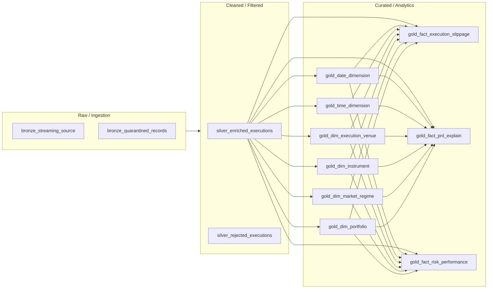
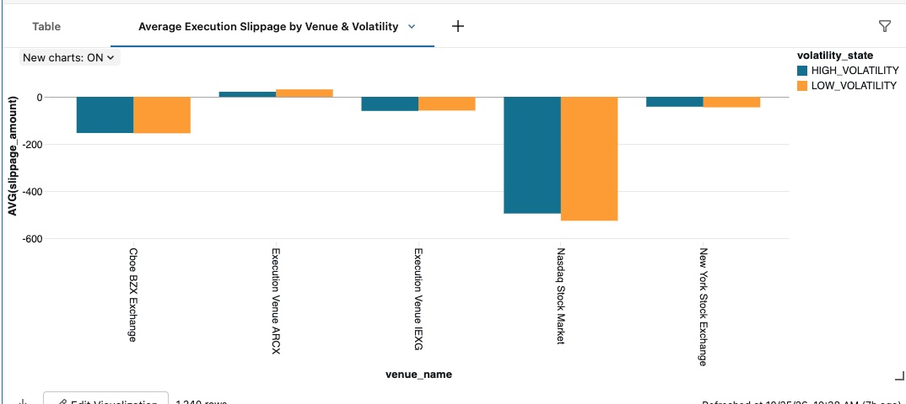
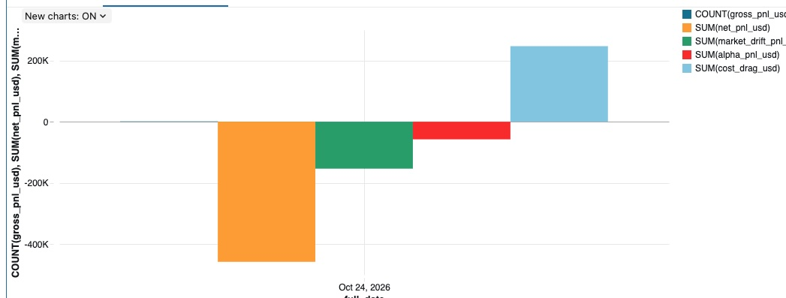

# ⚡ Alpha Factory: Real-Time Event Driven Data Pipeline

Alpha Factory is an institutional-grade financial market data platform designed to bridge the gap between raw, high-velocity quantitative feeds and alpha generation.

In modern quantitative trading and asset management, firms are frequently bottlenecked by brittle data ingestion, inconsistent historical data cleansing, and latency in transforming raw order book and execution streams into queryable analytical models. Alpha Factory solves this by providing a fully automated, serverless data pipeline that transforms raw market feeds into a pristine dimensional star schema, empowering quantitative researchers, portfolio managers, and algorithmic traders to backtest strategies, analyze execution quality, and monitor market microstructure in real time.

The Business Use Case & Core Capabilities
Alpha Factory is built to address three critical operational pillars in quantitative finance:

High-Frequency Data Ingestion & Normalization (Bronze Layer):
Continuously ingests high-throughput raw tick data, order book snapshots, and execution reports from disparate market venues using cloud-native Auto Loader, ensuring zero data loss and exact-once processing semantics.

Deterministic Cleansing & Enrichment (Silver Layer):
Standardizes timestamps across global time zones, deduplicates trades, resolves missing or malformed market ticks, and joins disparate quote and trade feeds into a unified, audit-ready operational store.

Dimensional Modeling for Quantitative Research (Gold Layer):
Constructs optimized star schemas (fact tables for trades/quotes, dimensions for assets, counterparties, and venues) inside Unity Catalog. This structure allows quants and portfolio managers to run complex historical queries, volume-weighted average price (VWAP) calculations, and slippage analysis instantly via serverless SQL warehouses.


This project demonstrates production-ready infrastructure provisioning via **Terraform**, modular deployment using **Databricks Asset Bundles (DABs)**, and low-latency stream ingestion with **Azure Event Hubs** and **Databricks Serverless Workflows**.

---

## 🏛 Architecture Overview

```
                   +-----------------------+
                   |  Azure Event Hubs     |
                   |  (Kafka API Endpoint) |
                   +-----------+-----------+
                               |
                               | Real-time Event Stream
                               v
                   +-----------------------+
                   |  Azure Databricks     |
                   |  Structured Streaming |
                   +-----------+-----------+
                               |
                               | Medallion Architecture
                               v
                   +-----------------------+
                   |  Delta Lake (Storage) |
                   |  - Bronze (Raw)       |
                   |  - Silver (Cleaned)   |
                   |  - Gold (Aggregated)  |
                   +-----------------------+
```

---

## Key Features & Highlights

* **Infrastructure as Code (IaC):** 100% automated provisioning of Azure Resource Groups, Event Hubs, Databricks Workspaces, and Azure Data Factory via **Terraform**.
* **Modern CI/CD Deployment:** Utilizes **Databricks Asset Bundles (DABs)** to manage, version, and deploy serverless workflows cleanly across environments (`dev`/`prod`).
* **Real-Time Stream Processing:** PySpark Structured Streaming with continuous checkpointing to handle high-throughput event logs.
* **Medallion Lakehouse Architecture:** Multi-hop pipeline converting raw unstructured payload data into query-ready, optimized Delta Lake tables.
* **Enterprise Security:** Identity-based access model utilizing Azure Managed Identities (MSI) and RBAC workspace permissions.

---

## 🛠 Tech Stack

| Category | Technologies |
| :--- | :--- |
| **Cloud Provider** | Azure |
| **Streaming Platform** | Azure Event Hubs (Kafka protocol) |
| **Compute & Processing** | Azure Databricks (Serverless PySpark) |
| **Storage & Format** | Delta Lake, Azure Blob / ADLS Gen2 |
| **IaC & Deployment** | Terraform, Databricks Asset Bundles (DABs) |
| **Languages** | Python, SQL, HCL |

---

## Data Model

Layered Architecture

Bronze: 
Ingests raw data from Azure Data Hub using Databricks Auto Loader. These tables act as the "Source of Truth" with minimal transformation.
Applied schema enforcement rejecting any record that does not meet the schema for further observation

Silver: 
Applies data cleaning and conforming the data for the gold layer tables.

Gold (Star Schema):
* Date dimension
* Time dimension
* Instrument dimension - Details about stocks, options, or crypto pairs (ticker, asset class, sector).
* Book/portfolio dimension - dentifies the trading strategy, book, or desk owner.
* Execution Venue dimension - Tracks which exchange, dark pool, or broker executed the trade.
* Market Regime dimension - Categorizes market conditions (e.g., high volatility vs. low volatility, trending vs. mean-reverting).

* Risk and performance fact - stores risk metrics calculated at the time of the event or daily snapshot
* Execution and slippage fact - stores slippage metrics
* PNL explain fact - store profit and loss metrics

Error handling:
There are 2 bronze and silver layer reject tables to contain rejected records for further analysis and impose data quality




---

## 🚀 Getting Started

### Prerequisites

* [Azure CLI](https://docs.microsoft.com/en-us/cli/azure/install-azure-cli) installed and logged in (`az login`).
* [Terraform CLI](https://developer.hashicorp.com/terraform/downloads) (>= 1.0.0).
* [Databricks CLI](https://docs.databricks.com/en/dev-tools/cli/index.html) configured.

### 1. Provision Infrastructure

```bash
# Clone repository
git clone https://github.com/your-username/alpha-factory-pipeline.git
cd alpha-factory-pipeline/terraform

# Initialize and apply infrastructure
terraform init
terraform apply -auto-approve
```

### 2. Deploy & Run Databricks Asset Bundle

```bash
# Validate bundle configuration
databricks bundle validate

# Deploy pipeline to workspace dev environment
databricks bundle deploy --target dev

# Trigger the pipeline job execution
databricks bundle run bronze_ingestion_run --target dev
```

---

## 🛡 Design & Security Decisions

1. **Shared Workspace Paths for Service Principals:** Asset Bundle deployments use dynamic `/Shared/` paths (`root_path`) to ensure service principal execution identities (such as ADF or automated job drivers) have complete read access to notebook artifacts.
2. **Serverless Compute:** Workflows utilize Databricks Serverless execution to eliminate cluster startup cold-starts, reduce idle infrastructure costs, and auto-scale compute based on incoming stream spikes.

## Results

Here are a couple of graphs.
Average Execution Slippage by Venue and Volatility

PNL

---

## 👤 Contact & Author

* **Name:** Arash Sadri
* **LinkedIn:** https://ca.linkedin.com/in/arash-sadri-3b70a9272
* **Email:** asadri@cleardwsolutions.com